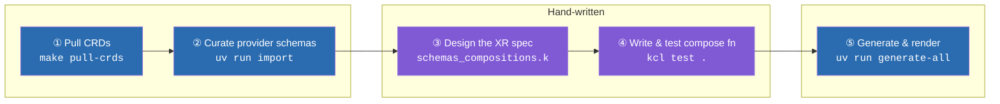
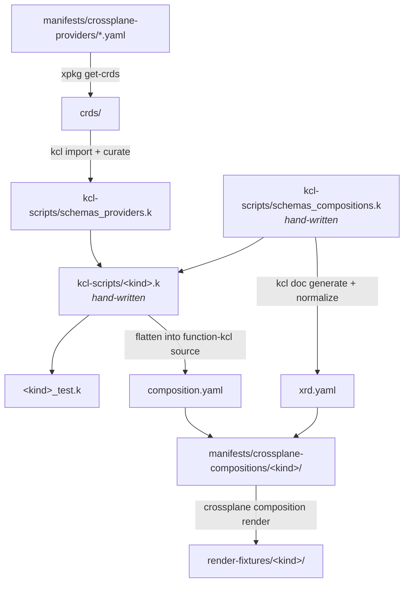

# Kiln

**Write the schema and the logic. Generate everything else.**

Kiln is a KCL-first authoring pipeline for Crossplane compositions. You shape
two things by hand: the API your platform's consumers see, and the logic that
turns that API into real cloud resources. Kiln then turns them into the
`Composition` and `CompositeResourceDefinition` that Crossplane runs.

## Why

Writing a Crossplane composition usually means maintaining a lot of things by
hand that are really just copies of each other:

- **AWS provider shapes.** These are retyped from docs or guessed from error
  messages, and they drift when a provider is upgraded.
- **The XRD's OpenAPI schema.** It's written separately from the code that
  reads it, so the two can disagree without anyone noticing.
- **Transformation logic.** It's buried in YAML patches or templated strings,
  and the only way to test it is against a cluster.
- **The Composition wrapper.** This is boilerplate that has to stay in sync
  with all of the above.

Most of this isn't design work. Only two parts need human judgment: deciding
what the consumer-facing API should look like, and deciding how it maps onto
managed resources. Kiln is built so that those two parts are the only things
you maintain. Everything else is generated from them.

What you get in return:

- **Typed provider schemas, pulled from the real source.** Provider CRDs come
  straight from the provider's OCI package (no cluster or credentials needed)
  and are imported into KCL with their field docs intact. A misspelled field
  becomes a compile error
  (`attribute 'buckett' not found in 'StaticWebsiteSpec', did you mean '["bucket"]'?`),
  not a reconcile loop.
- **Composition logic as plain functions.** Each kind is one pure function,
  `compose<Kind>(oxr, ocds) -> [resources]`, unit-tested with `kcl test`. You
  don't need Docker or a cluster to run the tests.
- **One source of truth for the XR's API.** The XRD's schema is generated from
  the same KCL schema your compose function is type-checked against, so they
  can't drift apart.
- **Real render checks.** Every generated Composition is run through
  `crossplane composition render`, which catches the class of bugs that pure
  KCL tests structurally cannot see.

## How it works

Kiln has five phases. Three are mechanical, meaning a command does the work.
The other two are where the actual platform design happens.



Here's how the pieces fit together on disk:



A compose function is ordinary, typed KCL:

```kcl
composeIAMRole = lambda oxr, ocds -> [any] {
    spec: schemas_compositions.IAMRoleSpec = oxr.spec

    _roleForProvider: schemas_providers.IamAwsmUpboundIoV1beta1RoleSpecForProvider = {
        assumeRolePolicy = _assumeRolePolicy
        managedPolicyArns = spec.managedPolicyArns
        tags = spec.tags
    }

    [{
        apiVersion = "iam.aws.m.upbound.io/v1beta1"
        kind = "Role"
        metadata.annotations = {"krm.kcl.dev/composition-resource-name" = "role"}
        spec.forProvider = _roleForProvider
    }]
}
```

## What's in the box

The repository ships four composite kinds, each built end to end through all
five phases:

| Kind | Composes |
|------|----------|
| `IAMRole` | IAM `Role` |
| `LambdaFunction` | Lambda `Function` + `FunctionURL` |
| `DnsValidatedCertificate` | ACM `Certificate` + `CertificateValidation`, plus a Route 53 validation `Record` |
| `StaticWebsite` | S3 `Bucket` + `BucketPolicy`, CloudFront `Distribution`, a Route 53 alias `Record`, and a nested `DnsValidatedCertificate` XR |

Consumers just apply an XR:

```yaml
apiVersion: platform.kcl-first.io/v1alpha1
kind: IAMRole
metadata:
  name: my-role
spec:
  roleName: my-role
  trustedService: lambda.amazonaws.com
```

## Getting started

You'll need the `crossplane` CLI, `kcl`, and `uv`.

```bash
make pull-crds              # ① fetch provider CRDs into crds/
(cd kcl-scripts && kcl test .) # ④ run every compose function's unit tests
cd tooling
uv run generate-all         # ⑤ regenerate every Composition + XRD
uv run render-all           #   render each kind against its fixtures
uv run pytest               #   automated render checks
```

To add a new kind, follow **[docs/onboarding.md](docs/onboarding.md)**. It
walks through each phase with the exact commands to run.

## Status

Kiln is an exploratory platform. The pipeline is proven end to end through
`kcl test` and `crossplane composition render`, but it hasn't been applied to a
real cluster or AWS account yet. Read
[`.scratch/kcl-first-platform/known-gaps.md`](.scratch/kcl-first-platform/known-gaps.md)
before trusting it with anything that matters.

## Further reading

- [`docs/onboarding.md`](docs/onboarding.md): a step-by-step guide to adding a kind.
- [`GLOSSARY.md`](GLOSSARY.md): definitions of `XR`, `XRD`, `MR`, `oxr`, and `ocds`.
- [`docs/adr/`](docs/adr/): standing architectural decisions.
- [`kcl-platform-spec.md`](kcl-platform-spec.md): the original design spike, with its experiments and findings.
