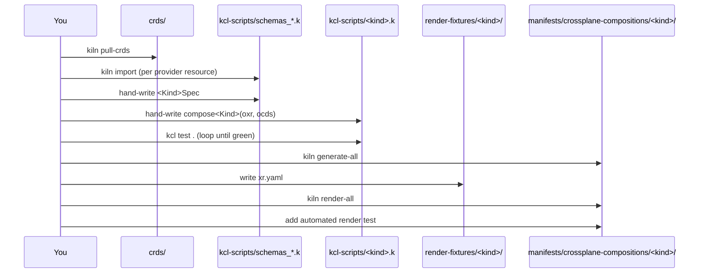

# Onboarding: using Kiln

> A standalone version of this guide ships with kiln: run `kiln docs` (and the topics it
> lists), or read the bundled skills under `.agents/skills/`. It has no
> references to this repo's example kinds, so it works in a project created by
> `kiln init`. The two overlap, so update both when the workflow changes.

This is a practical, run-these-commands guide to adding or updating a
composite kind on this platform. It does not explain how any of the tools
work internally — just what to run, in what order, and what you get out of
each step.

The platform has five phases. Every existing kind (`IAMRole`,
`LambdaFunction`, `DnsValidatedCertificate`, `StaticWebsite`) went through all
five, in order.


Blue steps are mechanical (a command does the work). Purple steps are the two
things you actually have to design and write by hand — everything else is
generated from them.

---

## Before you start — install `kiln` and find a project

Install the CLI once (it puts a `kiln` command on your `PATH`):

```bash
uv tool install "git+https://github.com/leprechaun/kiln#subdirectory=tooling"
```

Kiln is not on PyPI, so install it from GitHub like this, or run it without
installing by putting `uvx --from "git+https://github.com/leprechaun/kiln#subdirectory=tooling"`
in front of `kiln`. (Working on Kiln itself? Use `uv tool install --editable ./tooling`
from a checkout.)

Every `kiln` command works on a **project**: the nearest directory, searching
upward from where you run it, that contains a `kiln.toml`. This repo is one.
To start a new, empty one instead:

```bash
kiln init my-platform --group platform.example.com
cd my-platform
```

Run the commands below from anywhere inside the project, or pass
`--root <path>` to point at one from outside.

---

## Step 1 — Pull provider CRDs

**Command:**

```bash
kiln pull-crds
```

**What it does:** reads every provider listed in
`manifests/crossplane-providers/*.yaml` and downloads each one's CRDs
straight from its package — no live cluster, no AWS credentials.

The XRD is `Namespaced` unless you say otherwise. A kind that composes cluster-scoped resources needs
`scope = "Cluster"`: set it for the project in `kiln.toml`, per kind under `[kinds.MyKind]`, or for one
run with `kiln generate MyKind --scope Cluster`.

**What you get:** a `crds/` directory full of raw CRD YAML, one file per AWS
resource, organized by `<group>/<version>/<kind>.yaml`.

You only need to re-run this when you're adding a brand-new AWS provider (not
yet listed in `manifests/crossplane-providers/`) or upgrading an existing
one's version.

---

## Step 2 — Curate the provider schema you need

**Command:**

```bash
kiln import crds/<group>/<version>/<kind>.yaml
```

**What it does:** runs `kcl import` (which turns the raw CRD into a KCL
schema file with dozens of schemas — spec, status, Kubernetes boilerplate,
all of it), curates that down to just the one schema you actually need
(`<Kind>SpecForProvider` plus any nested types it references), and appends
the result straight onto `kcl-scripts/schemas_providers.k` — the one file
that accumulates every provider schema every kind needs. Cleans up its own
scratch directory; nothing to delete by hand.

Importing is safe to repeat: a resource's schemas are replaced in place, and any
of its schemas the provider no longer generates are dropped, so re-run it after
a provider version bump. It works with `kcl` 0.12 and 0.13, whose output
differs; schema names always come out group-prefixed (for example
`LambdaAwsmUpboundIoV1beta1FunctionURLSpecForProvider`) so two groups' kinds
with the same name can't collide.

Want to look at the curated schema before committing to appending it?

```bash
kiln import crds/<group>/<version>/<kind>.yaml --print
```

You'll usually need to curate more than one resource per kind — e.g.
`LambdaFunction` needed both `Function` and `FunctionURL`, so run `import`
once per resource.

---

## Step 3 — Design the XR spec

This is the first of the two hand-written steps.

**What to do:** open `kcl-scripts/schemas_compositions.k` and add a new
schema for your kind — e.g. `MyKindSpec`. Design it from the *consumer's*
perspective (what should someone configuring this resource actually be able
to set?), not by mirroring the raw AWS fields one-to-one.

Keep the spec schema closed, so a misspelt field is an error. Real Crossplane
XRs also carry runtime fields your schema doesn't declare (`spec.crossplane`);
the generated Composition passes your compose function only the declared ones.

**If your compose function returns status on the XR**, add a `<Kind>Status`
schema next to `<Kind>Spec` in the same file — e.g. `MyKindStatus`:

```kcl
schema MyKindStatus:
    someObservedField?: str
```

Keep the status schema closed too, so a misspelt status field fails type checking in the compose function. When
`kiln generate` finds a `<Kind>Status` schema it normalizes it like the spec
and declares it under `status` in the XRD. Kinds without one get a
spec-only XRD, as before. In the compose function, type the returned XR's
status against it, so a misspelt field fails `kcl test`:

```kcl
status = schemas_compositions.MyKindStatus {someObservedField = _observed}
```

---

## Step 4 — Write & test the compose function

This is the second hand-written step, and the one that actually encodes your
business logic.

**What to do:** create `kcl-scripts/<kind>.k` with a single function:

```kcl
compose<Kind> = lambda oxr, ocds -> [any] {
    spec: schemas_compositions.<Kind>Spec = oxr.spec
    ...
    [resource1, resource2, ...]
}
```

- `oxr` is the composite resource being reconciled (its `spec` is what the
  consumer set).
- `ocds` is a map of what's already been observed about resources you've
  previously emitted, keyed by whatever name you gave them.
- The function returns the list of resources this kind should compose.

**Reading observed state (`ocds`):** `ocds` is keyed by the
`composition-resource-name` annotation you gave each resource. Define each name
once as a constant and use it for both the annotation and the lookup, so the two
can't drift apart. Read the resource's `atProvider` through its generated
`<Kind>StatusAtProvider` schema (which `kiln import` brings in with the spec
schema), so a misspelt field is a compile error and not a silent `None`:

```kcl
_certificateName = "certificate"

_certificateStatus = lambda atProvider -> schemas_providers.<Prefix>CertificateStatusAtProvider {
    _status: schemas_providers.<Prefix>CertificateStatusAtProvider = atProvider
    _status
}
_observedAtProvider = ocds[_certificateName]?.Resource?.status?.atProvider
_observedCertificate = _certificateStatus(_observedAtProvider) if _observedAtProvider else None
_arn = _observedCertificate?.arn
```

The typed value is only built once the resource has an `atProvider`. Before
that (cold start) the whole chain is `None`, and every use of it must stay
guarded with `if` or `?.`.

Observed state from a nested XR you compose is its XR status, not a provider
`atProvider`. Read it with plain `?.` and don't cast it to a closed status
schema: Crossplane adds its own fields (such as `conditions`) to a real XR's
status, which a closed schema would reject.

The `StatusAtProvider` schemas are closed, so after you bump a provider version
run `kiln pull-crds` and then `kiln import` again for each resource you use.
Otherwise a field the new provider reports, which the old schema doesn't know,
fails at runtime and not in your tests.

**Test as you go:**

```bash
cd kcl-scripts
kcl test .
```

Create `kcl-scripts/<kind>_test.k` alongside it with `test_*` functions.
Write the test, watch it fail, write the minimal code to pass it, repeat.

**Naming note:** `kcl test .` compiles every file in `kcl-scripts/` together
as one package. Prefix your test function names and any shared
leading-underscore local variables with your kind's name (e.g.
`_myKindBaseOxr`, not `_baseOxr`) — a generic name will silently collide with
another kind's test file.

---

## Step 5 — Generate manifests and render

**Commands:**

```bash
kiln generate MyKind
```

It expects the spec schema to be called `MyKindSpec` and the plural to be
`mykinds`; override either with `--spec-schema` / `--plural`. The API group
comes from the project's `kiln.toml`.

**What it does:** turns your schema and compose function into a real
Crossplane `Composition` and `CompositeResourceDefinition` (XRD) — the two
files Crossplane actually needs to run this kind for real.

**What you get:** `composition.yaml` and `xrd.yaml` under
`manifests/crossplane-compositions/mykind/` — and *only* those two files
live there. (If `kiln.toml` sets `format = "jsonnet"`, you get `composition.jsonnet`,
`composition.k` and `xrd.yaml` instead, for tools like ArgoCD that evaluate jsonnet; start such a
project with `kiln init --format jsonnet`. `kiln render` then needs the `jsonnet` binary.) `manifests/` is deploy-only: everything under it is meant to be
pushed straight to a cluster, nothing else belongs there.

Once your kind exists, `generate-all` regenerates every kind's manifests in
one pass (handy after any schema or compose-function change):

```bash
kiln generate-all
```
```
✓ IAMRole
✓ LambdaFunction
✓ DnsValidatedCertificate
✓ StaticWebsite
```

**Then write a sample XR** — `render-fixtures/mykind/xr.yaml`, *not* under
`manifests/` — and render it for real:

```bash
kiln render MyKind
```

If your compose function reacts to observed state (most do), also render
with a mocked observed resource (also under `render-fixtures/mykind/`) to
check the later stages:

```bash
kiln render MyKind --observed-resources render-fixtures/mykind/observed-<something>.yaml
```

Or render every kind at once:

```bash
kiln render-all
```

**Finally** (in this repo), add an automated version of that render check so
it doesn't rely on anyone remembering to run it by hand. The `project`
fixture is this repo's Kiln project:

```python
# tooling/tests/integration/test_render_mykind.py
from kiln.render import render

def test_mykind_composition_renders_successfully(project):
    result = render(project, "mykind")
    assert result.returncode == 0, result.stderr
```

```bash
cd tooling
uv run pytest
```

---

## Doing all five end to end



That's the whole loop. Every one of the four existing kinds under
`manifests/crossplane-compositions/` is a working, rendered example of this
exact sequence — the fastest way to get unstuck on any step is to open the
matching file for an existing kind and copy the shape.

## Using a kind once it exists

None of the above is needed just to *use* a kind that's already built. Write
an XR and apply it:

```yaml
apiVersion: platform.kcl-first.io/v1alpha1
kind: IAMRole
metadata:
  name: my-role
spec:
  roleName: my-role
  trustedService: lambda.amazonaws.com
```

```bash
kubectl apply -f my-role.yaml
```

## Where to go next

- `.scratch/kcl-first-platform/spec.md` — the full spec this platform was built from.
- `.scratch/kcl-first-platform/issues/` — the six tickets, each with a "Findings" section documenting real bugs hit along the way.
- `.scratch/kcl-first-platform/known-gaps.md` — what's *not* yet proven, and what to watch out for.
- `docs/adr/` — the two standing architectural decisions (build from scratch, CRD source).
- `GLOSSARY.md` — the handful of domain terms (`XR`, `XRD`, `MR`, `oxr`, `ocds`) used throughout this doc.
