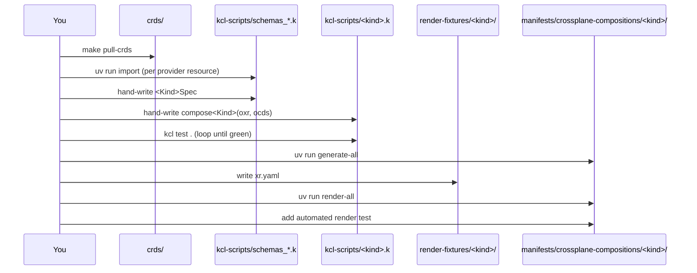

# Onboarding: using Kiln

This is a practical, run-these-commands guide to adding or updating a
composite kind on this platform. It does not explain how any of the tools
work internally — just what to run, in what order, and what you get out of
each step.

The platform has five phases. Every existing kind (`IAMRole`,
`LambdaFunction`, `DnsValidatedCertificate`, `StaticWebsite`) went through all
five, in order.


Blue steps are mechanical (a command does the work). Purple steps are the two
things you actually have to design and write by hand — everything else is
generated from them.

---

## Step 1 — Pull provider CRDs

**Command:**

```bash
make pull-crds
```

**What it does:** reads every provider listed in
`manifests/crossplane-providers/*.yaml` and downloads each one's CRDs
straight from its package — no live cluster, no AWS credentials.

**What you get:** a `crds/` directory full of raw CRD YAML, one file per AWS
resource, organized by `<group>/<version>/<kind>.yaml`.

You only need to re-run this when you're adding a brand-new AWS provider (not
yet listed in `manifests/crossplane-providers/`) or upgrading an existing
one's version.

---

## Step 2 — Curate the provider schema you need

**Command:**

```bash
cd tooling
uv run import ../crds/<group>/<version>/<kind>.yaml
```

**What it does:** runs `kcl import` (which turns the raw CRD into a KCL
schema file with dozens of schemas — spec, status, Kubernetes boilerplate,
all of it), curates that down to just the one schema you actually need
(`<Kind>SpecForProvider` plus any nested types it references), and appends
the result straight onto `kcl-scripts/schemas_providers.k` — the one file
that accumulates every provider schema every kind needs. Cleans up its own
scratch directory; nothing to delete by hand.

Want to look at the curated schema before committing to appending it?

```bash
uv run import ../crds/<group>/<version>/<kind>.yaml --print
```

You'll usually need to curate more than one resource per kind — e.g.
`LambdaFunction` needed both `Function` and `FunctionURL`, so run `import`
once per resource.

---

## Step 3 — Design the XR spec

This is the first of the two hand-written steps.

**What to do:** open `kcl-scripts/schemas_compositions.k` and add a new
schema for your kind — e.g. `MyKindSpec`. Design it from the *consumer's*
perspective (what should someone configuring this resource actually be able
to set?), not by mirroring the raw AWS fields one-to-one.

**One rule that always applies:** end every composition spec schema with an
open index signature:

```kcl
schema MyKindSpec:
    someField: str
    ...
    [str]: any
```

Real Crossplane XRs carry extra runtime metadata your schema doesn't declare
— without `[str]: any`, validating the real incoming resource against your
schema breaks. (This isn't visible in `kcl test` with hand-built fixtures; it
only shows up against a real resource. See `known-gaps.md` if you want the
full story — you don't need it to keep moving.)

---

## Step 4 — Write & test the compose function

This is the second hand-written step, and the one that actually encodes your
business logic.

**What to do:** create `kcl-scripts/<kind>.k` with a single function:

```kcl
compose<Kind> = lambda oxr, ocds -> [any] {
    spec: schemas_compositions.<Kind>Spec = oxr.spec
    ...
    [resource1, resource2, ...]
}
```

- `oxr` is the composite resource being reconciled (its `spec` is what the
  consumer set).
- `ocds` is a map of what's already been observed about resources you've
  previously emitted, keyed by whatever name you gave them.
- The function returns the list of resources this kind should compose.

**Test as you go:**

```bash
cd kcl-scripts
kcl test .
```

Create `kcl-scripts/<kind>_test.k` alongside it with `test_*` functions.
Write the test, watch it fail, write the minimal code to pass it, repeat.

**Naming note:** `kcl test .` compiles every file in `kcl-scripts/` together
as one package. Prefix your test function names and any shared
leading-underscore local variables with your kind's name (e.g.
`_myKindBaseOxr`, not `_baseOxr`) — a generic name will silently collide with
another kind's test file.

---

## Step 5 — Generate manifests and render

**Commands:**

```bash
cd tooling
uv run generate-manifests \
  --kind MyKind \
  --spec-schema MyKindSpec \
  --group platform.kcl-first.io \
  --plural mykinds \
  --kcl-dir ../kcl-scripts \
  --output-dir ../manifests/crossplane-compositions/mykind
```

**What it does:** turns your schema and compose function into a real
Crossplane `Composition` and `CompositeResourceDefinition` (XRD) — the two
files Crossplane actually needs to run this kind for real.

**What you get:** `composition.yaml` and `xrd.yaml` under
`manifests/crossplane-compositions/mykind/` — and *only* those two files
live there. `manifests/` is deploy-only: everything under it is meant to be
pushed straight to a cluster, nothing else belongs there.

Once your kind exists, `generate-all` regenerates every kind's manifests in
one pass (handy after any schema or compose-function change):

```bash
uv run generate-all
```
```
✓ IAMRole
✓ LambdaFunction
✓ DnsValidatedCertificate
✓ StaticWebsite
```

**Then write a sample XR** — `render-fixtures/mykind/xr.yaml`, *not* under
`manifests/` — and render it for real:

```bash
uv run render mykind
```

If your compose function reacts to observed state (most do), also render
with a mocked observed resource (also under `render-fixtures/mykind/`) to
check the later stages:

```bash
uv run render mykind --observed-resources ../render-fixtures/mykind/observed-<something>.yaml
```

Or render every kind at once:

```bash
uv run render-all
```

**Finally**, add an automated version of that render check so it doesn't rely
on anyone remembering to run it by hand:

```bash
# tooling/tests/integration/test_render_mykind.py
from tooling.render import render

def test_mykind_composition_renders_successfully():
    result = render("mykind")
    assert result.returncode == 0, result.stderr
```

```bash
cd tooling
uv run pytest
```

---

## Doing all five end to end



That's the whole loop. Every one of the four existing kinds under
`manifests/crossplane-compositions/` is a working, rendered example of this
exact sequence — the fastest way to get unstuck on any step is to open the
matching file for an existing kind and copy the shape.

## Using a kind once it exists

None of the above is needed just to *use* a kind that's already built. Write
an XR and apply it:

```yaml
apiVersion: platform.kcl-first.io/v1alpha1
kind: IAMRole
metadata:
  name: my-role
spec:
  roleName: my-role
  trustedService: lambda.amazonaws.com
```

```bash
kubectl apply -f my-role.yaml
```

## Where to go next

- `.scratch/kcl-first-platform/spec.md` — the full spec this platform was built from.
- `.scratch/kcl-first-platform/issues/` — the six tickets, each with a "Findings" section documenting real bugs hit along the way.
- `.scratch/kcl-first-platform/known-gaps.md` — what's *not* yet proven, and what to watch out for.
- `docs/adr/` — the two standing architectural decisions (build from scratch, CRD source).
- `GLOSSARY.md` — the handful of domain terms (`XR`, `XRD`, `MR`, `oxr`, `ocds`) used throughout this doc.
